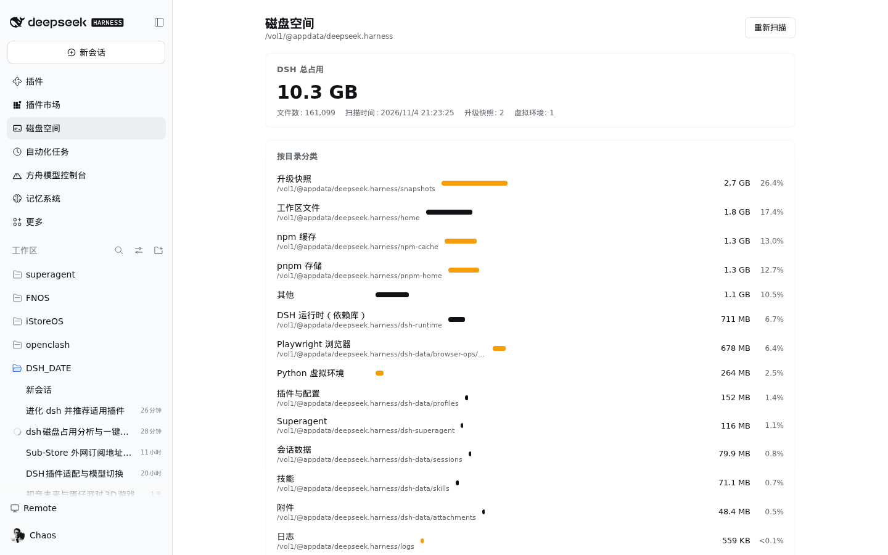

# dsh-disk-usage-plugin

A [DeepSeek Harness](https://github.com/deepseek-ai/deepseek-harness) (DSH) sidebar plugin that shows the real disk footprint of your DSH installation, breaks it down by directory and file type, and offers safe one-click cleanup of rebuildable caches.



## Features

- **Total footprint** of the DSH installation root (`dsh-data`, `dsh-runtime`, `home`, `snapshots`, npm/pnpm caches, …), measured with a concurrent filesystem walk.
- **By-directory breakdown** with per-category size, share and file count.
- **File-type statistics** (top 16 extensions by bytes).
- **Cleanup suggestions** with risk badges and selectable checkboxes:
  - safe: npm cache, pnpm store, Playwright browsers, runtime logs, `*.bak-*` leftovers
  - caution: old upgrade snapshots (keeps the newest), Python venvs under workspaces
- **One-click cleanup** of all selected targets — server-side whitelist only, requests never carry filesystem paths.
- Bilingual UI (中文 / English).

## Install

From a local checkout (bundle install):

```
plugin_manager install_bundle target=/absolute/path/to/dsh-disk-usage-plugin
```

Requirements: DSH ≥ 0.2.x with the `connection` fetch service (bundled with the web profile).

## How it works

- **Host half** (`index.js`) registers two exact Fetch routes inside Connection's authentication fence (only owner peers reach them):
  - `GET /api/disk-usage/scan` — full footprint report
  - `POST /api/disk-usage/clean` — execute whitelisted cleanup targets
- **Client half** (`client.js`) registers a sidebar panel icon (`sidebar.panellist`, order 5) and a keyed `main` panel via Cordis slots. Styles use DSH theme tokens (`--dsw-alias-*`) so light/dark both work.

### Notes for plugin developers

Static `client.js` files run as plain scripts: sandbox built-in symbols (`styles`, `host`, `ctx`) are **not** in scope. Insert your own `<style>` element instead of calling `styles.insert`, or activation will fail with a swallowed `ReferenceError`.

## Cleanup whitelist

| id | target | risk |
| --- | --- | --- |
| `npm-cache` | `npm-cache/_cacache`, `_npx`, `_logs` contents | safe |
| `pnpm-store` | `pnpm-home/store` contents | safe |
| `browsers` | `dsh-data/browser-ops/browsers` contents (re-downloaded on next use) | safe |
| `logs` | truncate `harness.log` / `info.log`, clear `logs/` | safe |
| `bak-files` | `*.bak-*` leftovers (depth ≤ 4, prunes `node_modules`, `snapshots`, `.git`) | safe |
| `snapshots-old` | delete all upgrade snapshots except the newest | caution |
| `venv` | `home/*/venv` directories | caution |

## License

MIT

---

[](https://github.com/deepseek-ai/deepseek-harness)
